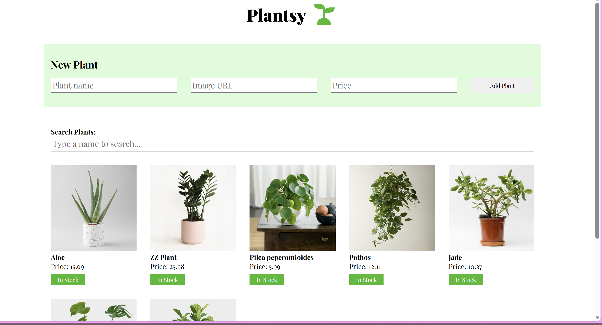

# Plantshop 

A React application for managing a plant store. Users can view available plants, add new plants, mark plants as sold out, and search for plants by name.

## Features

- Display all plants fetched from the backend when the application loads.
- Add new plants using the form.
- Mark plants as sold out.
- Search plants by name.
- Display filtered results based on the search input.

## Technologies Used

- React
- JavaScript
- CSS
- Vite
- JSON Server

## Getting Started

### Prerequisites

Make sure you have Node.js and npm installed.

### Installation

1. Clone the repository:

   ```bash
   git clone https://github.com/terecintamocheche-arch/react-hooks-plantshop-cr-vite.git
   ```

2. Navigate into the project:

   ```bash
   cd react-hooks-plantshop-cr-vite
   ```

3. Install dependencies:

   ```bash
   npm install
   ```

### Running the Application

Open two terminals.

**Terminal 1: Start the backend**

```bash
npm run server
```

The backend runs at `http://localhost:6001`.

**Terminal 2: Start the React application**

```bash
npm run dev
```

Open the local URL displayed in your terminal to view the application.

## API Endpoints

The backend uses JSON Server.

Base URL: `http://localhost:6001`

### GET /plants

Fetches all plants from the database.

```bash
GET http://localhost:6001/plants
```

### POST /plants

Adds a new plant to the database.

Required header:

```json
{
  "Content-Type": "application/json"
}
```

Example request:

```json
{
  "name": "Aloe",
  "

  ## Application Screenshot

